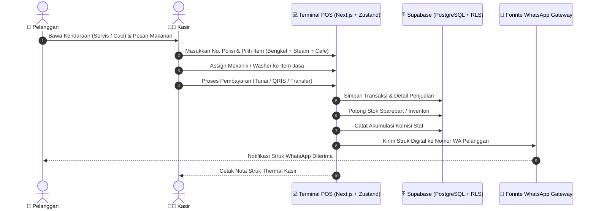

<div align="center">

# 🏍️ SK MOTOR POS
### All-in-One Point of Sale & Workshop Management System

**Sistem Kasir Terintegrasi Multi-Unit: Bengkel Motor, Cuci Steam, dan Kafe dalam Satu Struk Transaksi**

[](https://nextjs.org/)
[](https://www.typescriptlang.org/)
[](https://supabase.com/)
[](https://zustand-demo.pmnd.rs/)
[](https://tailwindcss.com/)
[](https://fonnte.com/)
[](LICENSE)

<br />

<p align="center">
  Solusi kasir modern dan manajemen operasional terpadu yang dirancang untuk otomotif terintegrasi. Memungkinkan kasir melayani pesanan suku cadang bengkel, jasa pengerjaan servis mekanik, cuci steam kendaraan, dan pesanan makanan/minuman kafe sekaligus dalam satu transaksi terpadu dengan e-receipt otomatis via WhatsApp.
</p>

[Fitur Unggulan](#-fitur-unggulan) •
[Arsitektur Alur Transaksi](#-arsitektur-alur-transaksi) •
[Tech Stack](#-tech-stack) •
[Panduan Menjalankan](#-panduan-menjalankan) •
[Manajemen Peran & Akun](#-manajemen-peran--role) •
[Struktur Proyek](#-struktur-proyek) •
[Lisensi](#-lisensi)

</div>

---

## ✨ Fitur Unggulan

- 🛒 **Multi-Unit Business in One Receipt**: Satu keranjang transaksi dapat mencakup 3 unit usaha sekaligus (**Bengkel Motor**, **Cuci Steam**, dan **Cafe**) dengan pemisahan kategori rapi pada struk cetak maupun digital.
- 📦 **Automated Inventory Tracking**: Pengurangan stok suku cadang & inventaris kafe secara otomatis dan realtime begitu transaksi pembayaran berhasil diproses.
- 🛵 **Database Kendaraan & Riwayat Servis**: Pelacakan riwayat servis, penggantian sparepart, dan pencucian berdasarkan nomor plat kendaraan konsumen.
- 👨‍🔧 **Sistem Komisi Staf Fleksibel**: Penugasan mekanik atau petugas washer pada tiap item layanan jasa untuk kalkulasi pembagian komisi harian/bulanan secara otomatis.
- 📲 **E-Receipt WhatsApp Otomatis**: Integrasi langsung dengan API Fonnte untuk mengirimkan bukti pembayaran & rincian nota langsung ke nomor WhatsApp pelanggan.
- 📊 **Laporan Finansial & Dashboard Metrik**: Ringkasan omzet harian, laba rugi kotor, riwayat transaksi lengkap dengan fitur *void* terproteksi, dan pencatatan kas keluar operasional.
- 🔐 **Role-Based Access Control (RBAC)**:
  - **Owner**: Akses penuh ke dashboard analitik, laporan laba/omzet, kelola staf & komisi, inventori produk, dan pengaturan sistem.
  - **Kasir**: Akses terisolasi khusus ke terminal POS dan pencarian database riwayat kendaraan.

---

## 🔄 Arsitektur Alur Transaksi



---

## 🛠️ Tech Stack

| Kategori | Teknologi | Peran & Penggunaan |
|---|---|---|
| **Framework** | [Next.js](https://nextjs.org/) | Full-stack React Framework (App Router & API Routes) |
| **Bahasa** | [TypeScript](https://www.typescriptlang.org/) | Strict typing end-to-end |
| **Backend & Database** | [Supabase](https://supabase.com/) | PostgreSQL, Autentikasi Pengguna, dan Row-Level Security |
| **State Management** | [Zustand](https://zustand-demo.pmnd.rs/) | Manajemen state keranjang kasir (cart) yang cepat dan reaktif |
| **Styling** | [Tailwind CSS](https://tailwindcss.com/) | Antarmuka kasir responsif & ramah layar sentuh (touchscreen) |
| **Notifikasi** | Fonnte API | WhatsApp Gateway otomatis untuk pengiriman e-receipt |
| **Desktop Launcher** | Batch & Exe Wrapper | Kemudahan eksekusi 1-klik untuk staf kasir di toko fisik |

---

## 🚀 Panduan Menjalankan

### Opsi 1: Menggunakan Launcher Cepat (Operasional Toko)
* **Windows Desktop**: Klik dua kali file `SK Motor POS.bat` atau executable di folder `dist/SKMotorPOS.exe`. Server lokal akan berjalan otomatis dan langsung membuka browser di `http://localhost:3000`.

### Opsi 2: Manual via Terminal (Development)

1. **Clone repository**:
   ```bash
   git clone git@github.com:muhamadjordysetiawan/sk-motor-pos.git
   cd sk-motor-pos
   ```

2. **Install dependensi**:
   ```bash
   npm install
   ```

3. **Konfigurasi Environment Variables**:
   Buat file `.env.local` di root direktori:
   ```env
   NEXT_PUBLIC_SUPABASE_URL=your_supabase_project_url
   NEXT_PUBLIC_SUPABASE_ANON_KEY=your_supabase_anon_key
   FONNTE_TOKEN=your_fonnte_whatsapp_api_token
   ```

4. **Jalankan Development Server**:
   ```bash
   npm run dev
   ```
   Buka [http://localhost:3000](http://localhost:3000) pada browser Anda.

---

## 👥 Manajemen Peran (Role)

Sistem menggunakan Supabase Authentication dengan metadata role. Buat akun di dashboard Supabase (`Authentication -> Users -> Add user`), lalu berikan role via Supabase SQL Editor:

```sql
-- Role: Owner (Akses Penuh)
UPDATE auth.users
SET raw_user_meta_data = jsonb_build_object('role', 'owner')
WHERE email = 'owner@skmotor.com';

-- Role: Kasir (Akses POS & Database Kendaraan)
UPDATE auth.users
SET raw_user_meta_data = jsonb_build_object('role', 'cashier')
WHERE email = 'kasir@skmotor.com';
```

---

## 📂 Struktur Proyek

```text
sk-motor-pos/
├── dist/                   # Standalone desktop executable launcher
├── public/                 # Logo, ikon, dan aset statis nota
├── src/
│   ├── app/                # Next.js App Router (POS, Dashboard, Laporan)
│   ├── components/         # Komponen kasir (Cart, ProductGrid, ReceiptModal)
│   ├── hooks/              # Custom hooks inventori & transaksi
│   ├── lib/                # Client Supabase & helper format rupiah
│   └── stores/             # Zustand store (cart, multi-unit filter, session)
├── supabase/               # SQL migrations & schema definisi tabel
├── SK Motor POS.bat        # 1-Click launcher untuk operasional Windows
├── package.json
└── tsconfig.json
```

---

## 📄 Lisensi

Didistribusikan di bawah lisensi [MIT License](LICENSE).

---

<div align="center">
  Dikembangkan untuk efisiensi bisnis oleh <b>Muhamad Jordy Setiawan</b>
</div>
